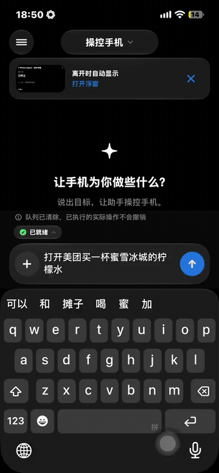
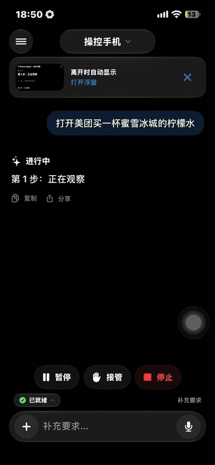
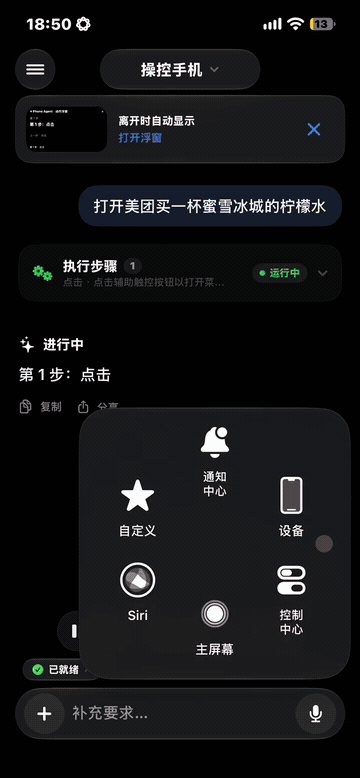
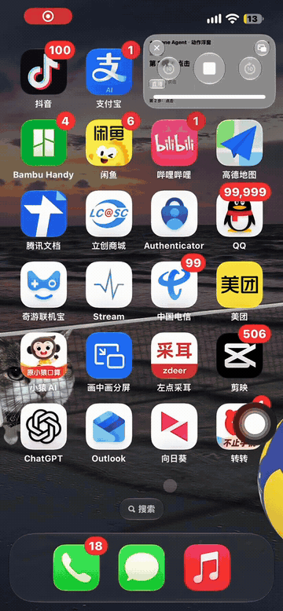
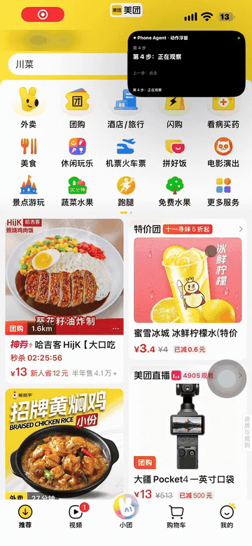
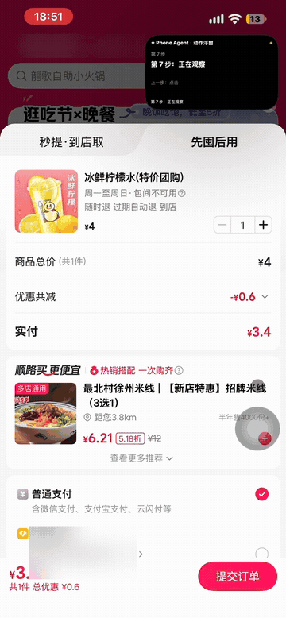

# iPhone Use Agent — 当前工作版本

当前界面合并版为 **Sela Build 77**，包含新版首页、Sela 图标、工具与连接及 iPhone 原生服务。构建、安装和真机验收边界见 [合并记录](docs/merge-20261024.md)。

原始基线为 2026-10-23 的工作版本，基于 [boboabw/phone-agent](https://github.com/boboabw/phone-agent) 源码提交 `a90045074afcd4de69f885fba25b0b171d690f45`。基线的真机记录见 [版本说明](docs/version-2026-10-23.md)；本地 Build 75 的新增代码尚未真机验收，不能沿用基线的真机成绩。

本版增加本地手机操作 Harness、已验证布局复用、结束画面复用、页面转换等待和模型历史过滤，并保留静态取屏唤醒、停止后完成记录保护等修复。日常任务由 iPhone App 调用模型，通过 ESP32-S3 蓝牙鼠标/键盘执行；Mac 用于开发、安装与签名更新。ESP32 需要供电，不需要通过 USB 与手机交换控制数据。

- 打开 `PhoneAgent.xcodeproj`，选择自己的签名 Team，并将示例 Bundle ID 改为个人唯一标识。仓库不包含个人签名配置或 API Key。
- 通用 ESP32-S3 与实测 XIAO ESP32-S3 配置见 [固件说明](docs/firmware.md)。
- 完整离线检查：`bash scripts/check.sh`；测试不要求真实聊天记录、API Key、手机或开发板。
- 关键使用流程、缺陷追踪及分层验收见 [测试与修复工程](docs/quality-engineering.md)。目录检查通过不代表产品验收通过。
- 本地 Harness 的能力、回退与验证边界见 [Harness 说明](docs/phone-harness.md)。

## 稳定性与文件管理（Build 75）

补充结合当前图像与页面结构的弹窗判断、逐文件人工核验及历史、原始关键画面与本地诊断导出、真实内容复用和原件归档/恢复/空间核算。长任务策略与未知提交不重发保持不变。支持条件与离线证据见 [Build 75 说明](docs/reliability-v4.md)；未安装手机或新增真机验收。

## 页面与联系人适配（Build 74）

本轮保留原有长任务功能，补齐普通联系人从真实资料页核号进入聊天、小红书常见中文/英文页面与筛选选中态核验、受控复制链接补来源，以及原生分享中的微信自动发送驱动。工作台的“长任务工作区”可保存准确会话、作者主页和自动发送范围。

自动发送要求实际扩展展示准确账号、完整原件清单、字节数与原件状态。仅有昵称或摘要时停止；本轮没有证明用户当前微信版本满足这些条件。未知提交不自动重发，真实设备、聊天、分享权限和后台行为尚待验收。使用方式与证据范围见 [Build 74 说明](docs/domain-adapters-v3.md)。

## 速度与准确性修改版（Build 71）

本地分支 `codex/speed-accuracy-20261023` 在原始提交 `b04a98f` 上修改。新增可追溯的分层计时、保守页面适配、带持久化回执的文件传输助手短文本流程、事件驱动画面等待、局部画面变化保护，以及手机本机正文保存和剪贴板准备。未知发送结果会暂停自动执行，须在设备页人工核对回执。

这是一版待真机验收的源码。新旧版同条件各三次的 60 秒 / 5 轮目标尚未验收；小红书批量采集、聊天分段总结、批量文件与朋友圈互动未在本轮完成。中文正文已能在手机本机保存及准备，但跨 App 粘贴、保存后全文核验尚未闭环。

- 修改与验收范围：[本轮说明](docs/speed-accuracy-v1.md)。
- 计时与对照统计：[运行记录](docs/run-metrics.md)；设置页可固定下一次起点并导出记录。
- 编译并绑定准确源码版本：`bash scripts/build-verified.sh simulator`（真机平台无签名编译使用 `device`）。普通 Xcode 编译若未传入源码标识，会明确记录为不可追溯。

## 长任务模式（Build 72）

默认开启长任务模式，取消任务总步数和执行器内置的 100 步截断。旧设置无需迁移操作；关闭“设置 → 任务执行 → 长任务模式”后，可继续使用 1–100 步的人工上限，达到上限会暂停并保留进度。

原始任务、后续补充及确认过的子任务账本持续传给模型。较早执行记录在本地滚动压缩，优先保存关键回执；压缩状态随任务历史和队列保存。记录省略与截断会明确标记，缺失细节不能当作已完成证据。具体行为和验证边界见 [长任务说明](docs/long-tasks.md)。

## 本地业务流程（Build 73）

保留 Build 72 的默认长任务、滚动历史压缩、原始要求与子任务账本、暂停续跑及停止保护。新增“记录与文件 → 小红书、聊天与文件发送”：

- 小红书：固定采集范围，本地连续读取、真实来源 ID 去重、逐批保存、断点续作；程序复算数量/缺失/比例/分布，模型单独分批处理新增可见文字。
- 聊天：会话与条数/日期范围、连续消息锚点、原始证据保存、增量读取和分批总结；事实/决定/待办/负责人/期限附原消息引用，未读媒体与范围缺口单列。
- 文件：查找原件、按选择顺序批量分享、真实 SHA256/大小核查与阶段回执；系统分享目标由用户选择，扩展回调保持待核验，未知项禁止自动重发。

Build 73 当时的边界（Build 74 的进展见上文）：小红书缺真实来源链接时只存待核验；聊天初始身份仍仅自动识别有独立系统说明的文件传输助手，普通联系人需稳定账号适配；微信 GUI 自动发送文件在缺少可信驱动时返回 unsupported。系统分享不会被写成“对方已收到”。使用方法、离线检查和剩余边界见 [本轮说明](docs/business-workflows-v2.md)。

以下保留原项目的功能与安装说明。

---

<div align="center">


# Phone Agent

**An AI assistant that sees your screen and operates your iPhone**

<p>
  
  
  
  
</p>

<a href="https://github.com/shkienao-pixel/iphone-use-agent/archive/refs/heads/main.zip"><b>Download Source</b></a> ·
<a href="#demo">Demo</a> ·
<a href="#requirements">Requirements</a> ·
<a href="#install">Install</a> ·
<a href="docs/firmware.md">Flash Firmware</a>

</div>

Phone Agent is a native iPhone AI assistant. It understands the screen you choose to share, then uses an ESP32-S3 Bluetooth mouse and keyboard accessory to move, click, and type.

> [!NOTE]
> This project currently provides development source code. Build and install the app with Xcode. Phone control requires an ESP32-S3 accessory, pointer calibration, full screen sharing, and a model that accepts images.

## Demo

Ask Phone Agent to open Meituan and find a Mixue lemon drink. These GIFs show each stage of the same iPhone recording at its original speed, with the action window visible during execution.

[Watch the full demo (MP4)](docs/demo/full-demo.mp4)

<table>
  <tr>
    <td align="center"><strong>1. Start a task</strong><br><br><br><sub>Describe what you want to do.</sub></td>
    <td align="center"><strong>2. Open AssistiveTouch</strong><br><br><br><sub>Open the system navigation menu.</sub></td>
  </tr>
  <tr>
    <td align="center"><strong>3. Return Home</strong><br><br><br><sub>Return to the Home Screen.</sub></td>
    <td align="center"><strong>4. Open Meituan</strong><br><br><br><sub>Find and launch the target app.</sub></td>
  </tr>
  <tr>
    <td align="center"><strong>5. Find drink deals</strong><br><br><br><sub>Navigate to the relevant offers.</sub></td>
    <td align="center"><strong>6. Inspect the results</strong><br><br><br><sub>Observe the screen before the next action.</sub></td>
  </tr>
  <tr>
    <td align="center"><strong>7. Select the lemon drink</strong><br><br><br><sub>Open the matching offer.</sub></td>
    <td align="center"><strong>8. Review the order</strong><br><br><br><sub>View the item and price before payment.</sub></td>
  </tr>
</table>

The recording ends at order review, before payment. Location and account balance are blurred; the published clips are silent.

## Features

**Phone control** — Observe the screen, generate an action, execute it, and observe the result. Queue tasks, pause or stop execution, take over manually, and add instructions during a task.

**Conversations** — Chat using text, dictation, shared screen images, or the camera. A separate configuration is available for real-time voice conversations.

**Files and tools** — Web search, memory, file and recording management, meeting notes, fishbone diagrams, and spreadsheets.

**System integration** — Siri and Shortcuts, Live Activities, and an action status window using Picture in Picture. Built with SwiftUI Liquid Glass, with light and dark appearances.

**Bluetooth accessory** — Mouse input, an ASCII keyboard, shortcuts, and pointer calibration in 21 steps. The GPIO48 RGB LED shows connection and task status: blue when disconnected, white when idle, rainbow during execution, red on failure, and green on completion.

## Requirements

- An iPhone running iOS 27.
- An ESP32-S3 development board and a USB data cable. The default firmware configuration uses 4 MB flash and a WS2812 RGB LED on GPIO48.
- An OpenAI-compatible model endpoint that accepts images, and your own API key.
- AssistiveTouch enabled, with accessory pairing, pointer calibration, and screen sharing completed.
- A Mac and Xcode 27 to build the app. Select your signing team for both targets when installing on an iPhone.
- ESP-IDF 5.5.4 to build the firmware.

## Install

1. Clone the repository and open the Xcode project:

   ```sh
   git clone https://github.com/shkienao-pixel/iphone-use-agent.git
   cd iphone-use-agent
   open PhoneAgent.xcodeproj
   ```

2. Select your signing team for the `PhoneAgent` and `PhoneAgentActivity` targets. Choose your iPhone, then build and run.
3. In a terminal with ESP-IDF activated, run `bash scripts/build-firmware.sh`. Follow the [firmware guide](docs/firmware.md) to flash the ESP32-S3.
4. In the app's model connection settings, enter your provider name, complete HTTPS endpoint URL, model ID, and API key. Confirm the data sharing consent.
5. Pair `AgentMouse-S3` in the system AssistiveTouch settings. Connect in the app and complete pointer calibration. Start full screen sharing, enter a task, and begin execution.

See [Setup and Usage](docs/setup.md) for detailed instructions.

## Project Structure

[GestaltEdit](https://github.com/frs0n/GestaltEdit) served as a reference for Swift source organization and README layout.

The Swift app separates its entry point, interface, coordination, services, and local storage. Shared models and the Live Activity extension live alongside the app; ESP32-S3 firmware has its own ESP-IDF project.

```text
phone-agent/
├── PhoneAgent.xcodeproj/          # App and Live Activity targets
├── PhoneAgent/
│   ├── PhoneAgentApp.swift        # App entry point and shared state
│   ├── ContentView.swift         # Main workspace and navigation
│   ├── PhoneAgentViewModel.swift # Task and interaction coordination
│   ├── Models/                   # Workspace and navigation types
│   ├── Views/                    # SwiftUI screens and components
│   ├── Services/                 # Capture, AI, BLE, voice, and tools
│   ├── Stores/                   # Settings and local persistence
│   ├── Appearance/               # Theme, glass surfaces, and motion
│   ├── Resources/                # Assets, strings, and privacy metadata
│   └── Debug/                    # Development review screens
├── Shared/                       # Data models and accessory protocol
├── Activity/                     # Live Activity and Dynamic Island UI
├── Skills/                       # Bundled phone control instructions
├── firmware/                     # ESP32-S3 BLE HID and GPIO48 RGB
├── scripts/                      # Firmware build and check entry points
├── Tests/                        # Existing offline checks
└── docs/                         # Setup, architecture, and build records
```

### Module Responsibilities

| Area | Responsibility |
| --- | --- |
| App and coordination | `PhoneAgentApp` creates shared state. `ContentView` presents the workspace. `PhoneAgentViewModel` connects user input, task execution, queue state, and services. |
| Views and appearance | SwiftUI pages present state and route user actions to the coordinator or services. `Appearance` centralizes light and dark themes, glass surfaces, and transitions. |
| Phone control | `AgentEngine` coordinates `CaptureService`, `VisionClient`, and `MouseExecutor`. `BLETransport` sends mouse and keyboard commands to the ESP32-S3. |
| Conversations and tools | Services handle assistant conversations, voice, camera input, web research, system actions, and file processing. Corresponding views provide their interfaces. |
| Local storage | Stores manage settings, task history and queues, memory, recordings, and service preferences. API credentials use the Keychain. |
| Shared types | `Shared` defines action, protocol, and feature data models. Live Activity attributes and controls are also compiled into the extension. |
| System surfaces | `Activity` renders Live Activities and Dynamic Island content. App services manage Activity updates, Picture in Picture, Siri, and Shortcuts. |
| Control instructions | `Skills` contains bundled instructions loaded by `PhoneControlSkill` for the visual phone control loop. |
| Accessory firmware | `firmware/main` implements BLE services, HID reports, command execution, and RGB status feedback for the ESP32-S3. |

### Where to Make Changes

- Add or update a screen in `PhoneAgent/Views`; use `Appearance` for shared styling.
- Add service behavior in `PhoneAgent/Services`, persistent state in `Stores`, and reusable data types in `Shared`.
- Update phone control rules in `Skills` and accessory commands in `Shared/MouseProtocol.swift` together with the firmware.
- Keep extension UI in `Activity`; shared extension types belong in `Shared` with the appropriate target membership.

Xcode uses synchronized source folders. Swift files inside those folders are included automatically, subject to target membership exceptions. `Skills` is explicitly bundled as a folder resource. See [Architecture](docs/architecture.md) for the execution flow and detailed component boundaries.

## Data and Runtime

API keys are stored in the iPhone Keychain. Tasks, memory, recordings, and files are stored locally. Shared screen images, task text, and relevant context are sent to your configured model service after the required consent.

Voice, Siri, Picture in Picture, BLE, and execution across apps require verification on an actual iPhone. Background execution is subject to iOS scheduling. Continuous listening for a wake word is not implemented. See [Verification](docs/verification.md) for build and offline check records.

## Development Docs

[Architecture](docs/architecture.md) · [Firmware and Protocol](docs/firmware.md) · [Setup and Usage](docs/setup.md) · [Checks and Build Records](docs/verification.md)
