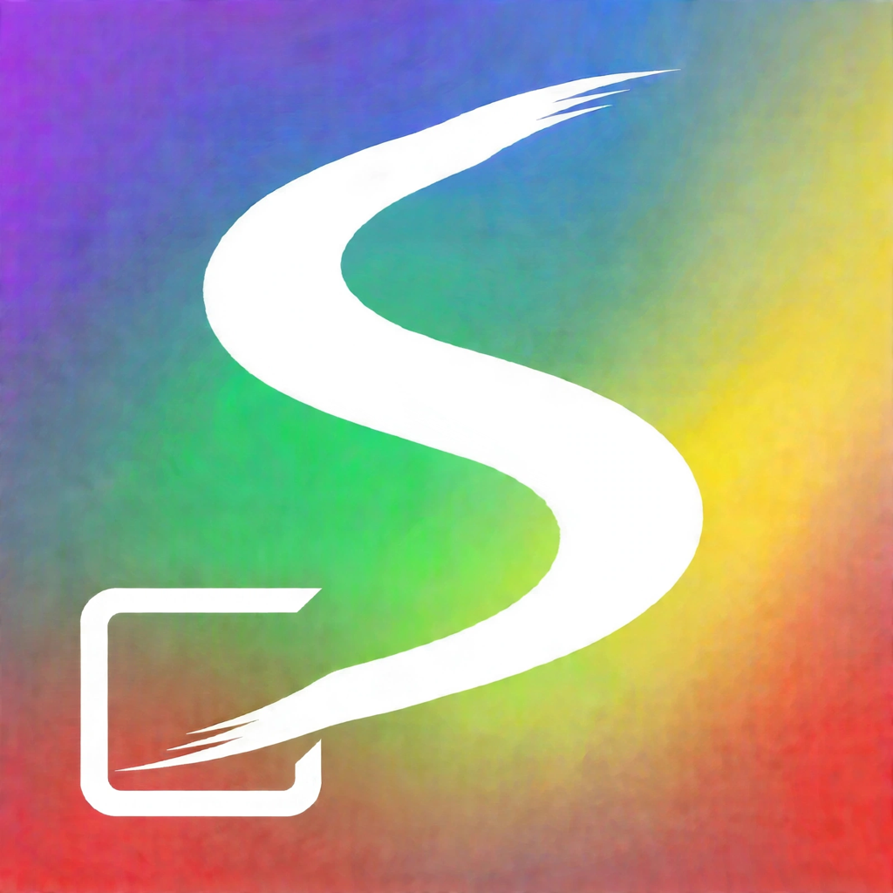

<div align="center">
  

# Sela

**看懂屏幕、帮你操作 iPhone 的 AI 助手**

SwiftUI · iPhone · ESP32-S3 · Bluetooth HID

[快速开始](#快速开始) · [工作原理](#工作原理) · [功能与现状](#功能与现状) · [开发与测试](#开发与测试) · [English](#english)
</div>

Sela 是一个原生 iPhone AI 助手项目。你可以用自然语言描述任务，授权共享屏幕，让模型观察画面并决定下一步，再由 ESP32-S3 蓝牙鼠标和键盘配件执行操作。Sela 也提供独立的助手对话、记忆和一些系统工具。

本仓库是开发源码，不是开箱即用的 App 安装包。当前源码版本为 **Build 238**；功能是否可用取决于模型、权限、设备、第三方服务和实际页面。请先阅读下面的限制与验证范围。

## 演示

[观看原始手机操控演示](docs/demo/full-demo.mp4)：从任务输入到打开美团、查看饮品并进入订单确认页面。录制结束于支付之前，画面中的位置和账户余额已模糊处理。该演示来自早期 Phone Agent，不代表 Build 238 的全部功能都已完成真机验收。

  

## 工作原理

```text
用户任务
   ↓
iPhone：经用户授权获取屏幕画面 → 发送画面和任务上下文给所配置的模型
   ↑                                      ↓
重新观察结果  ←  ESP32-S3 蓝牙 HID  ←  校验并执行模型给出的动作
                     ↓
              iPhone 鼠标 / 键盘输入
```

App 通过屏幕共享获取画面，模型生成下一步动作，App 校验后通过 BLE 控制 ESP32-S3 配件，由配件向同一台 iPhone 发送鼠标或键盘输入。每一步后再次观察画面。**蓝牙 HID 是输入通道，屏幕画面来自 iPhone 的屏幕共享；开发板需要供电，日常操作不需要通过 USB 与手机传输控制数据。** Mac 用于开发、编译、烧录和安装。

详见 [架构说明](docs/architecture.md) 和 [架构图](docs/architecture/2026-10-26/README.md)。

## 功能与现状

- **手机操控**：根据屏幕执行点击、移动、输入等动作，支持任务队列、暂停、停止、人工接管和追加指令。默认长任务模式使用滚动上下文与进度记录；详见 [长任务说明](docs/long-tasks.md)。
- **助手对话与记忆**：支持文本、语音输入、图片或相机上下文；记忆和会话由本机存储管理，部分实时语音功能需要独立配置。
- **系统能力与工具**：项目包含日历、提醒、联系人、健康、照片等原生能力的适配，以及网页检索、文件和录音管理等工具；具体能力和权限以应用内实际状态为准。
- **应用场景**：包含微信相关规则、携程行程卡片和滴滴对话卡片等集成或实验。滴滴本地模拟行程不是真实叫车订单；票价、库存、跳转和第三方页面应以实际服务为准。
- **系统界面与配件**：包含快捷指令、实时活动和画中画状态界面；ESP32-S3 提供鼠标、ASCII 键盘及指针校准。

Build 238 有模拟器构建和离线回归记录，但没有因这次源码同步而完成手机安装；微信完整自动操作、部分出行跳转和其他设备相关行为仍需真机复测。离线测试、模拟结果和真实业务完成是不同的证据。详见 [Build 238 同步与验证记录](docs/sync-20261027.md)。

## 运行要求

| 项目 | 要求 |
| --- | --- |
| 开发环境 | Mac、Xcode 27；工程最低部署目标为 iOS 27.0 |
| 手机 | iOS 27 iPhone；安装真机版本需要 Apple 开发者签名配置 |
| 手机操控配件 | ESP32-S3 开发板、用于烧录和供电的 USB 线；iPhone 开启辅助触控 |
| 固件 | ESP-IDF 5.5.4；默认配置针对 4 MB Flash、GPIO48 WS2812 灯 |
| 模型 | 支持图像输入的模型及可用连接；API 模式需要自己的服务地址、模型 ID 和密钥 |

模拟器可用于开发和部分界面检查，无法替代蓝牙、屏幕共享、语音或跨 App 操作的真机验证。XIAO ESP32-S3 的单独配置见 [固件说明](docs/firmware.md)。

## 快速开始

### 1. 获取并运行 App

```sh
git clone https://github.com/shkienao-pixel/iphone-use-agent.git
cd iphone-use-agent
open PhoneAgent.xcodeproj
```

选择 `PhoneAgent` Scheme。在 `PhoneAgent` 和 `PhoneAgentActivity` 两个 Target 的 **Signing & Capabilities** 中选择自己的 Team；如需修改 Bundle Identifier，保持扩展 ID 以 App ID 为前缀。选择模拟器或已解锁的 iPhone，构建并运行。不同 Apple 开发者账户可用的签名能力可能不同。

### 2. 编译并烧录配件

在已启用 ESP-IDF 5.5.4 的终端中，从仓库根目录运行：

```sh
bash scripts/build-firmware.sh
```

选择正确的串口并按 [固件说明](docs/firmware.md) 烧录。该文档也包含 XIAO 板型参数、指示灯及协议说明。

### 3. 配置模型

在 App 侧栏打开「工具与连接 → 模型与记忆 → 模型连接」，选择可用的连接方式并完成授权。API Key 方式需填写服务商、完整 HTTPS 接口地址、模型 ID 和 API Key，再测试连接。手机操控、识屏及相机对话需要支持图像的模型。首次使用或变更服务商后，按界面确认数据接收方。详见 [配置与运行](docs/setup.md) 和 [ChatGPT 计划连接](docs/chatgpt-plan-connection.md)。

### 4. 配对、校准并开始

1. 在 iPhone 设置中开启「辅助触控」，在其设备页面配对 `AgentMouse-S3`。
2. 返回 Sela 的「设备与校准」，连接配件并完成 21 步指针校准。改变指针速度、设备或相关设置后应重新校准。
3. 开启屏幕共享，在系统选择器中选择整屏。受保护的页面可能无法捕获。
4. 进入「操控手机」，输入任务并开始；执行时可以暂停、停止、接管或补充要求。

连接 BLE 不等于全部输入通道都已就绪；首次配对、系统权限和共享选择需要用户在 iPhone 上完成。遇到连接或校准问题，请参阅 [配置与运行](docs/setup.md)。

## 数据、权限与使用边界

API 密钥使用 iPhone Keychain 保存；任务、记忆、录音和文件由相应本地存储管理。使用模型或外部工具时，任务文字、共享画面及相关上下文可能发送给你选择的服务商，具体取决于功能和授权。屏幕可能包含私人信息，请在共享和运行任务前检查画面及服务商的数据政策。

模型和界面识别可能出错，第三方 App 的界面也会变化。涉及发送消息、付款、下单、取消或其他有后果的操作时，请核对对象、内容和实际结果；模型文字、模拟状态或分享回调本身不等于操作成功。iOS 后台运行受系统调度限制，连续唤醒词监听尚未实现。

## 项目结构

```text
PhoneAgent.xcodeproj/  Xcode 工程与构建配置
PhoneAgent/            SwiftUI App、服务、本地存储与资源
Shared/                跨 Target 数据模型与配件协议
Activity/              Live Activity 扩展
Skills/                随 App 打包的操作规则
firmware/              ESP32-S3 BLE HID 固件
Tests/                 离线检查和测试
Tools/                 辅助工具与连接验证
Experiments/           独立实验及其验证资料
docs/                  安装、设计、架构和验证文档
scripts/               构建与检查入口
```

## 开发与测试

```sh
# 项目离线检查；可能需要本机 Xcode / Swift 等工具
bash scripts/check.sh

# 记忆核心 Swift 包测试
swift test --package-path PhoneAgent/SelaMemoryCore
```

这些检查不能证明真实模型、手机、蓝牙、外部账户或交易流程可用。真机测试前请先备份数据，并按 [iPhone 测试清单](docs/iphone-test-checklist.md) 和 [验证记录](docs/verification.md) 区分构建、离线检查、模拟器与实际设备结果。功能改动请同步对应测试和文档；不要提交 API Key、账户数据、录屏或个人配置。

## 更多文档

- [配置与运行](docs/setup.md) · [ESP32-S3 固件](docs/firmware.md) · [源码结构](docs/architecture.md)
- [长任务与恢复](docs/long-tasks.md) · [记忆](docs/memory.md) · [手机操作 Harness](docs/phone-harness.md)
- [微信相关说明](docs/wechat-skill.md) · [携程连接](docs/ctrip-connection.md) · [滴滴模拟](docs/didi-simulation.md)
- [Build 238 同步记录](docs/sync-20261027.md) · [测试与验证](docs/verification.md)

## 来源与许可

Sela 的早期源码基于 [boboabw/phone-agent](https://github.com/boboabw/phone-agent) 的 `a90045074afcd4de69f885fba25b0b171d690f45`；Swift 源码组织和 README 的早期布局参考了 [GestaltEdit](https://github.com/frs0n/GestaltEdit)。第三方名称和图标属于各自权利人。

本项目采用 [MIT License](LICENSE)。第三方名称、商标及素材的权利归各自权利人所有；MIT 许可不授予其商标使用权。

## English

Sela is a native iPhone AI assistant built on the earlier [Phone Agent](https://github.com/boboabw/phone-agent) project. With user-approved screen sharing, a vision-capable model observes the screen and the app sends actions to an ESP32-S3 Bluetooth HID accessory. Screen capture and input are separate paths; a Mac is used for development and installation.

The repository contains development source for Build 238. You need Xcode 27, an iOS 27 iPhone, an ESP32-S3 with ESP-IDF 5.5.4 firmware, and a configured vision-capable model to use phone control. See [setup](docs/setup.md), [firmware](docs/firmware.md), and [architecture](docs/architecture.md). Device behavior and third-party integrations require real-device validation. Simulated ride progress is not a real order. The project is available under the [MIT License](LICENSE). Third-party names and trademarks belong to their respective owners.
