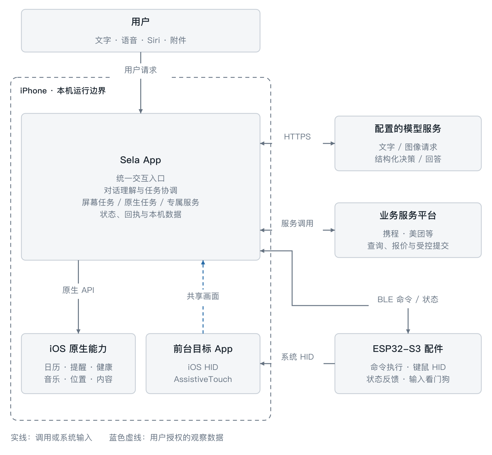
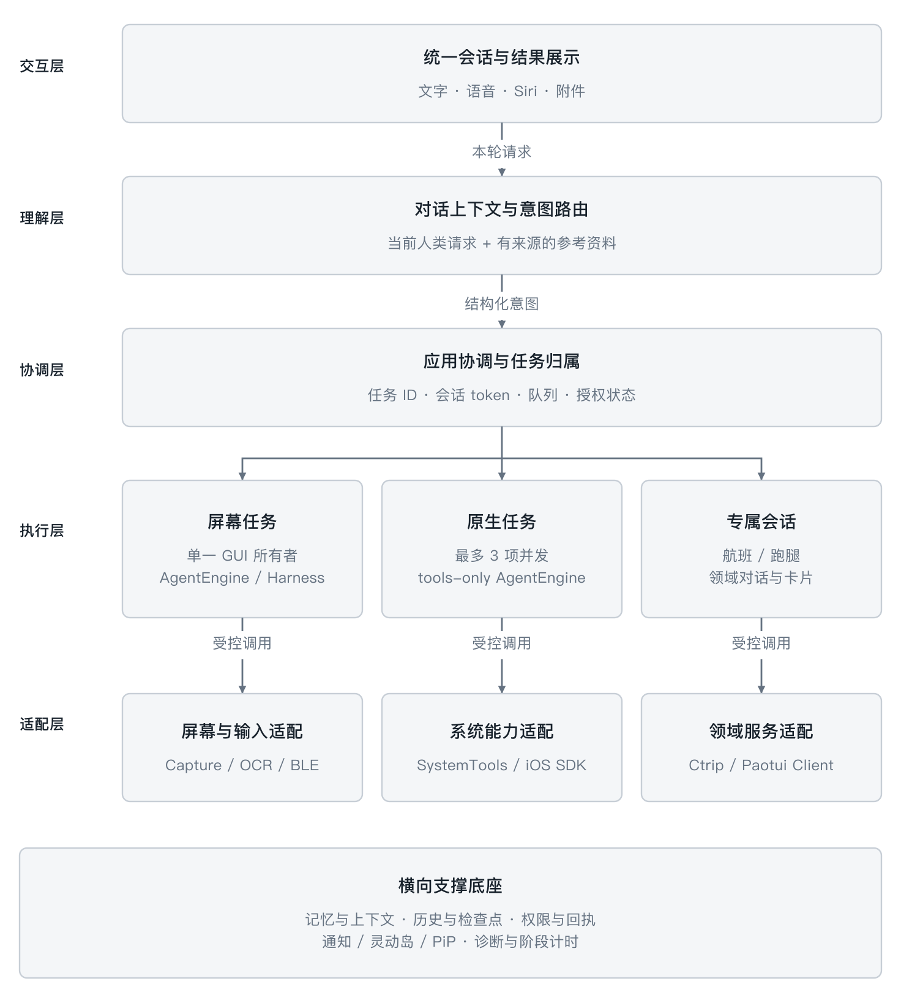
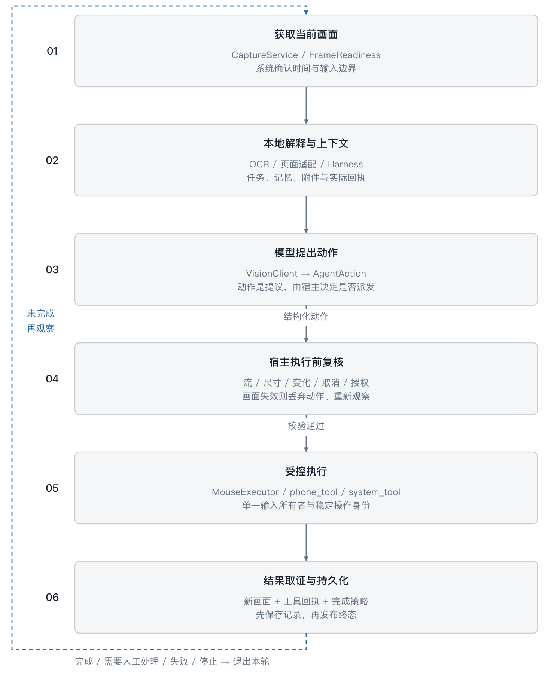
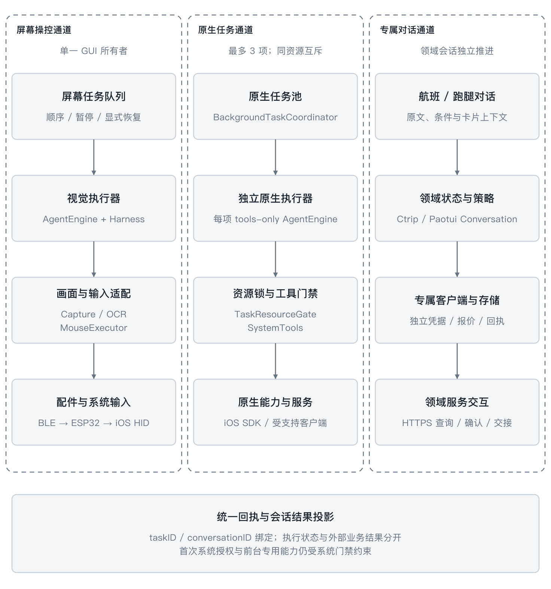
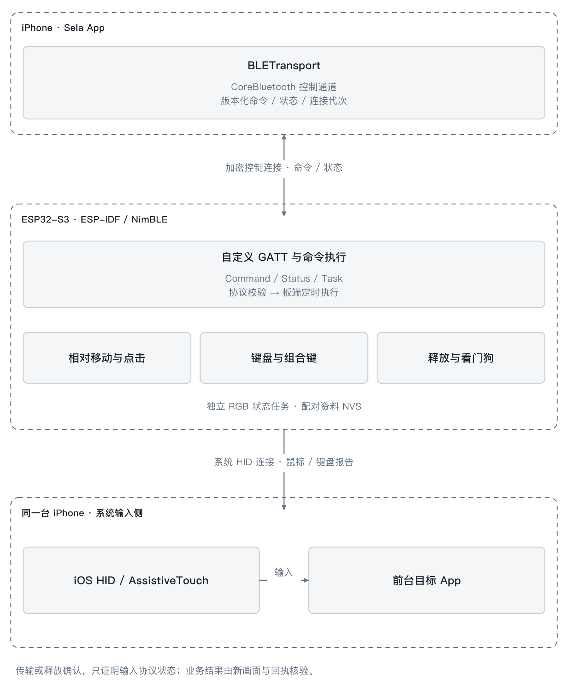
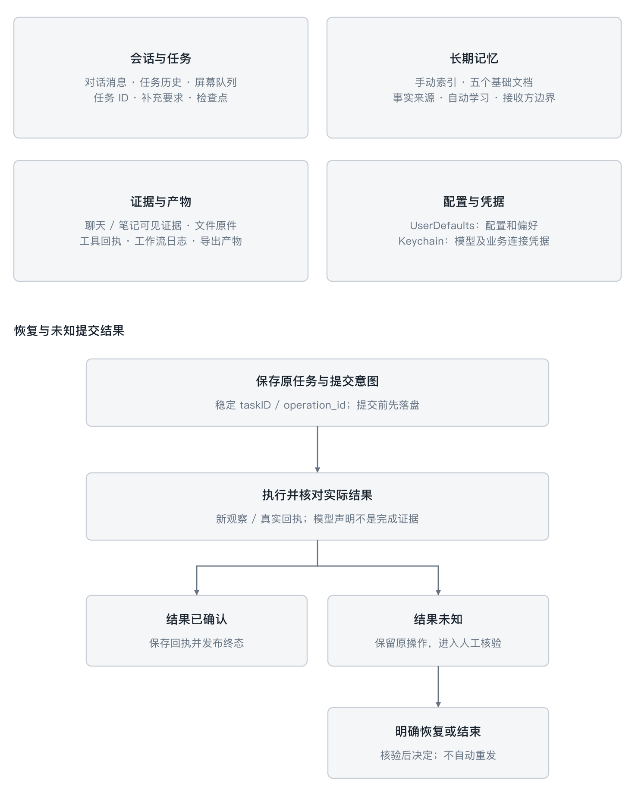

# Sela 项目架构图

2026-10-26 清晰版：一张系统总图与五张专题图，按运行边界、应用分层、执行流程和数据职责组织。

本页可直接查看全部图。点击图片可放大；每张图也提供 SVG 矢量版本。交互版本见 [index.html](index.html)，下载后用浏览器打开，可切换专题并展开源码映射。GitHub 的文件页面展示 HTML 源码，不直接运行交互页面。

## 版本与范围

图基于 2026-10-26 本地可靠性工作副本的源码审阅，包含当时尚未提交的增量。此次提交只上传架构文档与图，不同步其他 App 源码改动，也不表示所有功能已经完成真机验收。源码映射中的行号对应审阅时工作副本，仓库后续变更可能不同。

主运行边界是 iPhone、配置的模型与业务服务、ESP32-S3 配件。历史 AirPlay/Mac 路线与动作选择、跑腿重构等实验保留在交互版附录，不混入主运行链路。

## 1. 系统总览

iPhone 内的 Sela、系统能力和前台目标 App，与手机外模型服务、业务平台、ESP32 的关系。

[SVG 矢量版](images/system.svg)

## 2. App 分层

交互、理解、协调、执行和适配分层；记忆、检查点、权限、状态与诊断作为公共支撑。

[SVG 矢量版](images/layers.svg)

## 3. 手机操控闭环

获取当前画面、本地解释、模型提议、宿主复核、受控执行、结果取证；未完成时重新观察。

[SVG 矢量版](images/loop.svg)

## 4. 三条任务通道

屏幕任务单一输入所有者、原生任务最多三项并发、专属对话直接进入领域服务。

[SVG 矢量版](images/lanes.svg)

## 5. 配件协议

自定义 BLE 控制连接与系统 HID 输入连接分别管理，作用于同一台 iPhone。

[SVG 矢量版](images/hardware.svg)

## 6. 数据与恢复

会话任务、长期记忆、证据产物、配置凭据分域保存；未知提交结果先核验，再决定恢复。

[SVG 矢量版](images/data.svg)

## 可编辑资料

- [图形定义](source/diagrams.js)：六张图的布局、文案与连线。
- [源码映射](source/source-map.json)：职责、边界说明和相对源码位置。`local-snapshots/`、`upstream-snapshot/`、`workspace-evidence/` 表示审阅时的本地实验或历史资料，不表示相应文件已经提交到本仓库。

