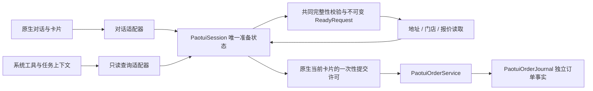

# Sela 美团跑腿对话流程

美团连接页管理账号授权，并可打开独立的订单核验视图；购买、取送、地址选择和订单创建确认在 Sela 对话中进行。

## 2026-10-27 架构重构第五轮（已完成）

准备快照独立于订单日志保存，仅包含经过脱敏的需求线索、缺失项与本机凭据范围。连接页的恢复动作必须指向仍在本机的原对话；它创建新的 Session，不恢复卡片、报价或提交许可。地址必须在恢复会话重新读取并选择，门店重新查询，费用重新询价。相同 token 的新授权也拥有新的 epoch；凭据范围相同不代表美团已证明稳定账号身份。

快照使用白名单 schema v1、受保护的原子写入。损坏或未来格式保留原字节并停用恢复。清除用独立 tombstone 阻止旧准备再被提供；保存失败时保留明确错误并隔离旧文件。Session 注册表与保存条数分别有界；读取、提交和等待模型期间按独立请求令牌保护，不由旧请求的 defer 释放新请求的保护。

订单日志 schema v3 兼容旧数组／v1／v2，新增可缺失的原尝试关联数据和凭据范围标签。新提交从原 grant 记录 conversationID、sessionID、revision、quoteID 与 credentialEpoch；历史缺失不补造。人工核验还可保存可选的用户报告订单编号，仍带结论、时间与来源；它不成为 providerOrderID，也不赋予查询平台订单、支付或深链的权限。

归档先持久化已解决记录及受保护的归档页，再更新主日志清单与裁剪；未决记录始终留在主日志。中途失败／重启只接受完全等同的副本，冲突或损坏保守停止。主清单和内容摘要检查缺页、变更与未知版本；原有创建回执的链接、状态查询与顺序在归档后继续有效。保护边界是每页 2 MB、最多 256 页且总读取 64 MB；达到边界不会丢弃事实。

诊断只接收枚举分类、UUID 关联、版本、耗时与结果，最多保留 512 条事件／在途 span；不接收凭据或指纹、电话、用户详情、载荷或令牌。原生连接页与 DEBUG 设备诊断均采用同一安全快照。模型返回后也再次检查本轮的模型／接收方／记忆许可，未批准的内容不能先进入准备再仅被界面隐藏。

具体迁移与拒绝条件见 [状态迁移表](paotui-state-transitions.md)。所有恢复、核验与归档动作都不表示付款或取消订单。按最新交付范围，非 Didi 并行改动已在独立交付副本中整合、验证，原工作区的 Didi 改动保留。第五轮完成后停止；最终构建、测试计数与未验证边界见架构迭代计划。真实设备与真实服务能力按实际取得的证据另行标注。

## 2026-10-26 架构重构第四轮

`PaotuiModule` 统一接收文字、原生卡片与系统工具输入；工具走只读查询适配器，携带任务及调用身份。`PaotuiHostContext` 明确携带原会话和宿主请求 ID；清空事件同步撤销对应 Session。宿主对文字和卡片共用 `LiveRequest`、完成与取消逻辑：允许后台完成的文字回复仍回原对话；最终确认保持前台操作；取消后不补发迟到的聊天回复，已发出订单的回执仍独立保存。

路由读取现存 Session 的只读 `PaotuiSessionSummary`，没有 Session 时返回空，不根据历史卡片重建准备或权限。界面通过宿主获得当前可执行动作，模块变更直接通知 ViewModel，报价到期由定时呈现检查更新。核验或授权变化后不能只依赖下一条聊天消息才刷新按钮。卡片由纯投影器完整生成，然后登记到 Session；摘要、历史和投影都不包含提交许可。

`PaotuiInterpretationPatch` 将模型建议转换为保持／设置／清除三种变更，并绑定开始解释时捕获的 Session 票据及本轮用户输入。解除“只询价”需要当前用户直接表达下单意愿；模型结合历史或附件输出 false 不会解除。指定门店替换也会撤销旧的就近购买方式，避免沿用不同的购买路径。真实地址和令牌仍由执行边界持有。

金额由 CNY 和整数分表达，提交字符串、日志 v2、查询 JSON、摘要和卡片的金额文字使用同一份精确值。HTTP 解码保留原始金额数值，避免 Foundation 在接收长小数时先行舍入；不支持的精度、负数、溢出和明确的其他币种会被拒绝。旧 v1 回执迁移到 v2，缺失或不可信的历史费用继续未知，未决记录保留。报价的有效期只由 `PaotuiQuote.validUntil` 计算。

工具调用必须有任务 ID，工作台仅可查询；无上下文提交重载与 `legacyWorkbench` 例外已移除。所有提交都必须消费当前原生会话的完整确认卡片。展示和模型投影会脱敏电话，包括供应商将电话放进联系人姓名、地址或描述的情形；真实取送请求保留在执行边界中。

## 2026-10-26 架构重构第三轮

当前会话准备由 `PaotuiSession` 唯一持有。对话控制器负责解释与选择，Store 负责连接、会话索引和服务调用；两者不再另存一份可变需求或报价。兼容工作台属性也只投影同一种 Session。准备按 `conversation / task / workbench` 标明入口来源，task 从创建时就只允许查询。

Session 包含需求、真实门店引用、报价、当前完整卡片与有类型的阶段。每个实例有随机 sessionID，需求变化推进 revision，授权替换推进连接 epoch；异步操作使用开始时保存的票据，不能在结束时重新读取当前 revision 来冒充旧操作仍有效。单次读取另有独立 ID，防止 A→B→A 的相同草稿让旧结果重新生效。

| 事件 | Session 行为 | 订单事实 |
| --- | --- | --- |
| 新文本或修改需求 | 撤销旧报价、卡片与提交许可；保留必要的准备信息 | 不删除 |
| 异步读取返回 | 验证实例、revision、epoch 与读取 ID；过时则拒绝发布 | 不创建订单 |
| 选择报价 | 选中当前原始报价，额外费用确认绑定该报价 ID | 不创建订单 |
| 点击最终确认 | 消费完全匹配的当前卡片，取得一次性许可；调用方同 ID 的替换载荷无效 | 先持久化尝试，再单次发送 |
| 清空后同会话重开 | 新实例拥有新 sessionID，旧模型／读取不能复活准备 | 在途回执仍归原尝试 |
| 授权更换或人工核验 | 撤销相关报价；核验成功后必须重新询价 | 已有或未知记录继续独立保留 |

`PaotuiDraft` 的服务、重量和品类可以缺失；`validated()` 才能生成不可变 `PaotuiReadyRequest`。原生对话与工具都调用这份校验：帮买无需取送重量；帮取送要求实际重量、品类与取件地址；不把未知服务、1 公斤或食品当默认值。

`PaotuiQueryResult` 在构造时就移除请求载荷、凭据、完整电话及令牌。输出是有来源、查询时间与完整性标记的 JSON，按完整记录限制长度，引用和价格不截断。每个任务只获得实际输出记录中的地址／门店引用；过滤、条数限制或字符预算未输出的引用没有被授权。引用相同但内容已变化时，旧引用许可撤销，重新输出才可使用。别的任务、连接页或原生对话读过地址，不赋予本任务使用权。

这一轮仍保留宿主兼容接口。路由的活跃判断、统一宿主生命周期、页面变更发布和 workbench 提交通路移除列入第四轮，不能把核心 Session 已收敛误报为整条宿主链路已完成。

## 2026-10-26 架构重构第二轮

订单与连接已形成独立的生产核心：

| 模块 | 权威职责 |
| --- | --- |
| `PaotuiOrderJournal` | 唯一持有版本化回执、旧格式迁移和逐笔人工核验事实；先提交磁盘再发布内存 |
| `PaotuiOrderService` | 提交锁、唯一发送、类型化结果、迟到回执落盘、已创建订单状态查询 |
| `PaotuiConnection` | PKCE 授权会话、凭据版本与取消／替换失效；不打开链接或直接读钥匙串 |
| `PaotuiHTTPTransport` | 有界普通 HTTP、无重定向／Cookie／缓存；与 MCP/SSE 解码分离 |
| `PaotuiProductionRuntime` | 唯一组装真实钥匙串和 UIKit 链接打开器；提供生产 shared 实例 |

`MeituanPaotuiStore` 委托上述服务，继续作为现有界面的兼容门面。提交返回 `created / notDispatched / outcomeUnknown`，对话直接采用这份结果，不能从共享消息文案猜订单状态。即使重新安装相同 token，授权 epoch 也会撤销旧报价及过期界面发布权限；原尝试的实际回执仍先保存在日志中。

同一个连接时钟贯穿请求时间、授权有效期、报价创建／过期、模型输入参考时间和订单核验时间。模型解释与普通外卖链接打开均作为显式依赖传入，对话核心不再构造模型客户端或引用 UIKit。

离线用例直接编译生产核心原文件，使用真实的授权／连接／订单类型；不再删除 import 或声明同名平台替身。第三轮继续收敛 Store 与对话控制器中重复的需求／报价状态，第二轮不把兼容门面误报为最终单一 Session。

## 2026-10-26 架构重构第一轮

本轮在独立分支 `codex/paotui-architecture-20261026` 实施，长期计划和后续验收见 [架构迭代计划](paotui-architecture-plan.md)。本轮先补行为和恢复闭环，单一 Session、订单服务及连接依赖的完整拆分在后续轮次推进。

- 清空对话通过通用生命周期回调撤销该对话的跑腿准备与旧确认；晚到的模型、地址、门店和报价结果不能复活它。已创建和未知订单回执继续保留，已发出提交仍先落盘。
- 地址、门店或费用读取失败会保留需求并生成有效恢复卡。可恢复的网络读取提供“重新查询”；确定性校验失败提供“修改需求”。取消、失效 scope 和提交未知结果不进入读重试。
- 提交结果未知时，可从跑腿卡片或连接页进入独立核验视图，逐笔记录人工结论和时间。仍不确定继续保持提交限制；处理一笔不清掉其他未决记录；人工判断不变成平台订单或付款状态。
- 核验成功保存后，旧报价及核验前已经发出的询价结果均失效；保留需求和真实门店引用，需要主动重新询价。核验写入失败不解除限制，也不撤销原有只读查询。
- 订单日志使用 `schemaVersion: 1`，兼容迁移旧数组：pending 保守映射 unknown，created 保留真实订单号，reviewed 不补造核验结论。未知版本或损坏日志保留原文件并阻止提交。新内容完成保护与备份元数据后才原子替换，成功后发布内存。
- `preview_send` 缺实际重量或品类时在请求报价前拒绝；不再默认 1 公斤食品。帮买不增加重量门槛。项目 Skill 与工具说明同步更新，工具仍只有查询权限。
- DEBUG 排版夹具不挂载真实订单核验控件；订单摘要只保留静态服务／品类及跑腿费，旧记录缺失摘要和费用时明确显示未知。

## 用户流程

1. 用户可以先提出模糊需求。AI 提取本次新增或修改的信息，缺少物品、购买方式、取送重量时继续询问。
2. 地址来自当前授权的美团地址簿，在对话里点击选择，也可以输入关键词、“第二个”等。更多地址保留当前筛选条件。
3. 指定商户时，按送达地址附近的真实门店结果展示选择卡片。门店距离排序不等于已核实营业、库存或菜单。
4. 商品、购买／取件地址、送达地址、重量和备注先形成需求核对卡。点击“信息无误，查询费用”才请求报价。
5. 费用卡展示实际跑腿费、距离和时效。帮取送比较普通送与一对一急送；帮买商品费未知时，商品费与完整总价保持待确认。
6. 选择方案后出现独立的对话确认卡。只有这张当前有效的卡片上的明确创建动作才能提交。支付由本人在美团完成。

“只询价／不下单”保留为本次需求限制，地址或商品变化不会清除。用户明确改变该限制后，仍需重新询价并点击最终确认。文字“确认”不会直接触发提交。

## 三轮迭代

| 轮次 | 修改与验证 |
| --- | --- |
| 对话完整性 | 自然语言更换地址、关键词与中文序号选择、筛选分页、跨城市变更后重新选择门店、取送重量及品类核对、备注清空 |
| 报价与提交 | 询价限制由宿主执行；旧卡片、不同会话和重启后的卡片不能授权下单；报价到期提示与刷新；高费用在每个新报价上重新确认；未知提交结果不重试 |
| 呈现与诊断 | 原生卡片示例预览、真机签名构建与独立模拟器编译；模型接口显示 HTTP 状态和已知安全分类，禁止回显服务商原始错误正文 |

生产控制器和真实对话宿主均使用离线注入的 HTTP／模型响应测试；这类测试不能证明真实模型识别质量、美团当前价格、手机跨 App 跳转或真实支付成功。

## 边界

- 当前接入的是跑腿帮买和帮取送。普通外卖的实时菜单、购物车和平台订单流程尚未接入。
- 跑腿报价没有提供商品价与库存；不能将配送费标成完整餐价。没有门店深链时只提供真实的美团入口。
- 授权凭据、真实电话、报价令牌和支付令牌保留本机，不存入对话卡片或发送给需求提取模型。
- 未知提交先保存待核验记录并阻止再次提交。新的未知订单不能使用旧成功订单的链接冒充回执。读报价仍可继续。
- 用户此前手动创建的待支付订单未被本轮工作取消或支付。

## 2026-10-25 验证记录（历史）

手机拔线前安装的是 Build 102。第一轮真实对话遇到模型接口错误；模型列表请求成功不能证明对话推理接口成功。已补充安全错误分类，但本轮离线迭代未取得该次错误的实际 HTTP 状态，根因仍待重连复测。

当轮最新版本为 Build 103，真机签名包与模拟器版本均编译成功，签名和冻结源码身份已核对。483 项相关离线检查通过：跑腿 API／授权／订单记录 72 项、原生跑腿对话与卡片宿主 69 项、联网聊天与安全错误分类 33 项、通用对话宿主 161 项、对话路由 148 项。模拟器另有 1 个原生卡片界面用例通过，检查地址选择 → 信息核对 → 费用明细 → 询价不能提交，并保留 4 张截图。这些历史构建和安装记录不表示本轮重构已经安装到手机。

Mac 离线环境不能使用 iOS 的完整文件保护写入选项，已按系统分别处理；iPhone 继续使用完整文件保护。保存订单记录失败会在请求提交接口前停止，并显示本机记录保存错误，不再误报为网络问题。

最新构建、测试日志、源码身份与模拟器预览见 [验证记录](</Users/sh/Documents/ChatGPT/Gui Agent/output/meituan-native-20261025/iteration3/verification.json>)。最新离线版本尚未安装到用户手机。没有通过此次离线验证创建真实订单或支付。

卡片截图均使用明确标注的示例数据：[选地址](</Users/sh/Documents/ChatGPT/Gui Agent/output/meituan-native-20261025/iteration3/previews/01-address-card.png>)、[核对需求](</Users/sh/Documents/ChatGPT/Gui Agent/output/meituan-native-20261025/iteration3/previews/02-request-review.png>)、[费用明细](</Users/sh/Documents/ChatGPT/Gui Agent/output/meituan-native-20261025/iteration3/previews/03-price-card.png>)、[询价不能提交](</Users/sh/Documents/ChatGPT/Gui Agent/output/meituan-native-20261025/iteration3/previews/04-inquiry-cannot-submit.png>)。
